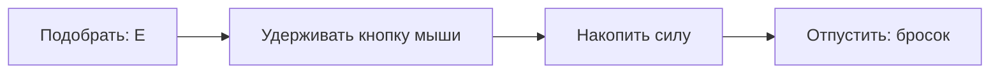
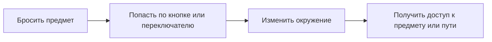

# Механика броска предметов

## 1. Идея

Игрок управляет ребёнком от третьего лица в небольшой комнате. Он подбирает и бросает предметы, например игрушечные кубики, чтобы взаимодействовать с окружением и продвигаться дальше. Контекст реализации — Unity.

## 2. Подбор

Игрок подходит к доступному предмету и нажимает **E**, чтобы взять его и подготовить к броску.

## 3. Бросок

Игрок удерживает кнопку мыши, накапливая силу броска, и отпускает её, чтобы бросить предмет. Точные значения силы и времени накопления здесь не задаются.

Пояснительная схема управления:

## 4. Наведение и прыжок

*Предоставленный референс из другой игры: пример положения камеры, удержания коробки и отображения направления броска.*

Во время прицеливания точка в центре экрана помогает выбрать направление, а отображаемая траектория показывает, куда полетит предмет. Это визуальные подсказки для самостоятельного броска.

Игрок самостоятельно выбирает направление броска. Помощи в прицеливании и автоматического выбора цели нет. Бросать можно в том числе во время прыжка.

## 5. Предметы и лава

Брошенный предмет остаётся там, где приземлился, в том числе если он попал в лаву.

Если в лаву падает игрок, он возвращается в безопасную точку.

## 6. Роль в прохождении

Броски существенно влияют на продвижение: некоторые предметы и пути доступны только после броска. Попадания по кнопкам и переключателям меняют окружение и открывают возможности для дальнейшего прохождения.

Пояснительная схема взаимодействия:

## 7. Примеры для прототипа в Unity

- **Вентилятор.** Попасть кубиком в высоко расположенный переключатель, включить вентилятор и с его помощью добраться до предмета.
- **Коробка.** Попаданием по коробке или её механизму вызвать срабатывание, после которого из коробки выпадает предмет.

В прототипе проверяем полный цикл: подбор → накопление силы → бросок → попадание → изменение окружения → продвижение. Отдельно проверяем бросок в прыжке, сохранение предметов в месте падения и возврат игрока из лавы в безопасную точку.
