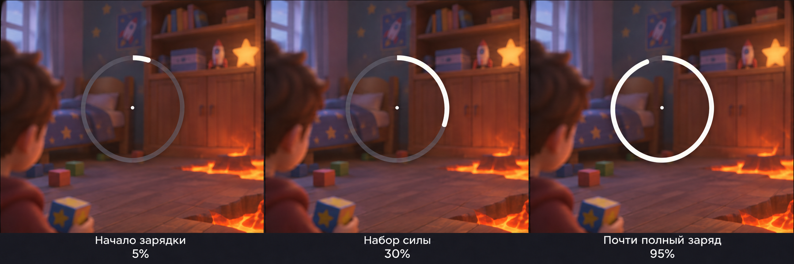
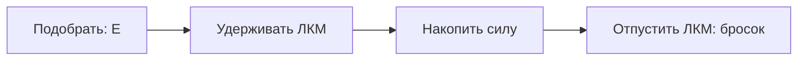
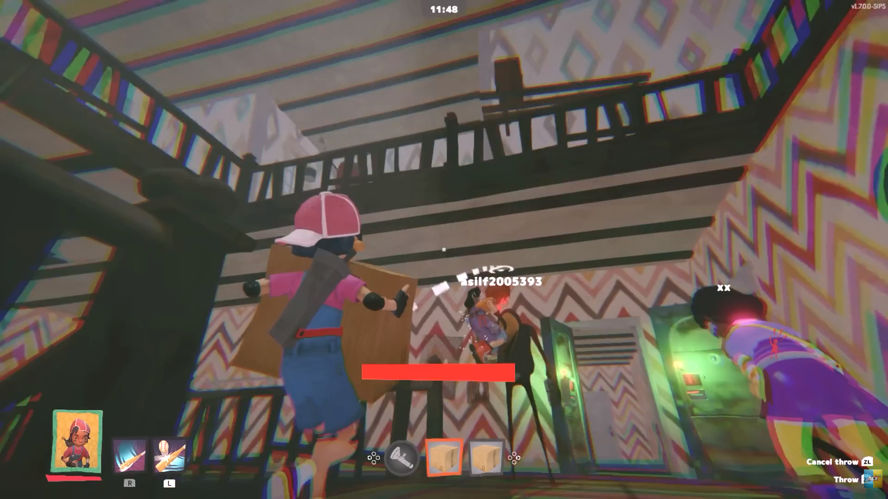
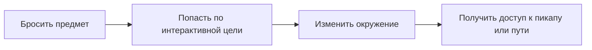

# GDD — Механика подбора и бросания предметов

**Статус:** Черновик / MVP  
**Движок:** Unity  
**Тип игры:** 3D-платформер от третьего лица

## 1. Общее описание

Игрок управляет ребёнком, который перемещается по небольшой детской комнате, избегая лавы на полу и собирая 25 пикапов за минимальное время.

В комнате расположены интерактивные предметы, например игрушечные кубики, которые игрок может подбирать, переносить и бросать.

Бросание предметов является одной из основных механик игры. Оно позволяет взаимодействовать с окружением, активировать механизмы, перемещать физические объекты и открывать доступ к пикапам и новым путям.

Часть пикапов и путей должна быть недоступна без использования механики броска.

## 2. Подбор предмета

- Игрок приближается к предмету на расстояние взаимодействия.
- Если предмет можно подобрать, появляется подсказка `E — Поднять`.
- При нажатии `E` предмет перемещается в руку персонажа и закрепляется в определённой точке.
- Пока предмет находится в руке, он перемещается вместе с персонажем и не должен мешать его движению.
- Одновременно игрок может держать только один предмет.
- Подбирать предметы можно независимо от того, запущено ли испытание.

Для первого прототипа достаточно одного типа переносимого предмета — игрушечного кубика.

## 3. Зарядка и бросок

Когда персонаж держит предмет, он может бросить его с регулируемой силой.

**Управление:**

- Удержание ЛКМ — зарядка силы броска.
- Отпускание ЛКМ — бросок предмета.
- Чем дольше игрок удерживает кнопку, тем сильнее бросок.
- После достижения максимальной силы дальнейшее удержание не усиливает бросок.

Предварительное время полной зарядки — 1 секунда. Значение уточняется при тестировании.

*Сгенерированная иллюстрация индикатора силы броска. При удержании ЛКМ кольцо вокруг прицела заполняется по часовой стрелке. Проценты под кадрами — пояснения к иллюстрации, а не элементы игрового интерфейса. Прицел увеличен для наглядности.*

Пояснительная схема управления:

**Направление броска:**

Бросок выполняется в направлении прицеливания игрока, с учётом положения камеры от третьего лица.

Система не использует автоприцеливание, притягивание предмета к цели или автоматическую коррекцию промахов.

После броска предмет движется по физической траектории под действием гравитации и сталкивается с окружением.

Бросать предметы разрешено как на земле, так и во время прыжка.

## 4. Визуальная обратная связь

*Источник изображения: Secret Neighbor. Визуальный референс камеры, удержания предмета и прицеливания.*

Во время удержания предмета игрок видит небольшой прицел — точку в центре экрана. При прицеливании отображается предполагаемая траектория полёта предмета. Эти подсказки помогают игроку самостоятельно выбрать направление броска и не корректируют его автоматически.

При зарядке броска вокруг прицела появляется кольцевой индикатор силы, который постепенно заполняется по часовой стрелке (см. иллюстрацию в разделе 3).

При отпускании кнопки проигрывается анимация броска, после чего предмет начинает физическое движение.

В момент попадания в интерактивную цель проигрывается соответствующая визуальная и звуковая реакция.

## 5. Физическое поведение предметов

После броска предмет:

- Подчиняется гравитации.
- Сталкивается с мебелью, стенами, полом и другими физическими объектами.
- Может отскакивать или воздействовать на лёгкие предметы.
- Остаётся в комнате после завершения движения.
- Может быть снова подобран, если игрок способен до него добраться.

Если предмет падает в лаву, он остаётся там, где приземлился. Автоматическое возвращение предметов не предусмотрено.

Если в лаву падает игрок, он возвращается в безопасную точку.

При полном перезапуске испытания предметы и интерактивные механизмы возвращаются в исходные состояния.

## 6. Взаимодействие с окружением

Предусмотрены два базовых типа взаимодействий.

**Тип A — Активация механизмов**

Брошенный предмет может попадать в специальные цели: кнопки, переключатели или другие интерактивные объекты.

При попадании активируется связанное действие: открывается дверца, запускается механизм, перемещается платформа и т. д.

**Тип B — Физическое воздействие**

Брошенный предмет может толкать или сбивать физические объекты.

Например, попадание кубика в коробку заставляет её упасть. В результате может открыться доступ к пикапу или измениться расположение объектов в комнате.

Пояснительная схема взаимодействия:

## 7. Примеры игровых ситуаций

Броски создают разные задачи: попасть в цель, изменить окружение, выбрать момент для прыжка или подготовить путь к пикапу.

**1. Потолочный вентилятор**

Игрок бросает кубик в переключатель и запускает потолочный вентилятор. Затем забирается на шкаф и прыгает на вращающуюся лопасть. Двигаясь вместе с ней, игрок выбирает момент и направление следующего прыжка, чтобы добраться до пикапа.

Здесь бросок запускает механизм, а дальнейшее прохождение требует выбора момента для прыжка.

**2. Пикап на высокой полке**

Пикап находится на высокой полке или шкафу. Игрок попадает в него кубиком, сбивает вниз и подбирает в доступном месте.

Место падения нужно расположить так, чтобы пикап можно было забрать, не заходя в лаву.

**3. Подъёмная платформа**

Игрок подбирает кубик и встаёт на низкую подъёмную платформу. С неё он бросает кубик в переключатель, который расположен в стороне и недоступен для взаимодействия рукой.

После попадания платформа поднимается вместе с игроком. Теперь он может перейти или перепрыгнуть на высокий участок комнаты с пикапами.

**4. Коробка с пикапом — дополнительный вариант**

На краю мебели стоит коробка с пикапом. Игрок сбивает её кубиком. Коробка падает, и из неё выпадает пикап, который теперь можно подобрать.

Здесь бросок меняет расположение предметов и делает награду доступной.

**5. Откидной мостик — дополнительный вариант**

Между двумя предметами мебели находится поднятая откидная доска. Игрок бросает кубик в переключатель, доска опускается и образует мостик над лавой.

По новому пути игрок добирается до следующего участка комнаты и пикапов.

Для первого прототипа достаточно проверить три основные ситуации. Коробку и мостик можно добавить позже, если они дают достаточно отличающийся игровой опыт.

## 8. Возможности для будущих версий

Идеи ниже рассматриваются как направления развития и не входят в текущий MVP:

- **Последовательность механизмов.** Несколько бросков постепенно меняют комнату: открывают доступ к следующему переключателю и в итоге создают путь к пикапу.
- **Перенос кубика по маршруту.** Игрок перебрасывает кубик на следующий участок, добирается туда сам и использует его для новой задачи.
- **Временное окно.** Попадание запускает механизм на ограниченное время. Игрок заранее выбирает позицию и после броска должен успеть пройти открывшийся путь.
- **Несколько способов решения.** Один пикап можно сбить кубиком или добраться до него, активировав механизм. Игрок выбирает удобный способ.

Эти идеи стоит проверять после того, как базовые подбор, прицеливание, бросок и физические взаимодействия станут удобными.

## 9. Ограничения первой версии

Для MVP не предусматриваются:

- Автоматическая помощь в наведении.
- Различные характеристики силы броска для разных предметов.
- Ограниченное количество бросков.
- Система инвентаря.
- Автоматическое возвращение потерянных предметов.
- Специальные способности броска в прыжке.

Обычный бросок во время прыжка доступен; отдельные способности для него не требуются.

Основная задача первой версии — проверить, насколько удобно подбирать предметы, регулировать силу броска и взаимодействовать с окружением.

В прототипе Unity проверяем полный цикл: подбор → накопление силы → бросок → попадание → изменение окружения → продвижение. Отдельно проверяем бросок в прыжке, сохранение предметов в месте падения, возврат игрока из лавы в безопасную точку и ситуации, где получить пикап или открыть путь можно только броском.
